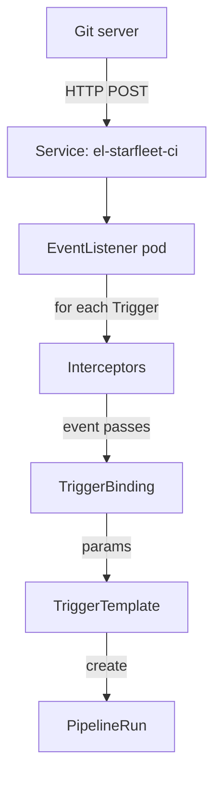

# Install Tekton Triggers And Meet Its Resources

Tekton Pipelines knows how to run a `Pipeline`, but it never decides when. Something has to create the `PipelineRun`, and in continuous integration (CI) that something should react to the Git server, not to a person typing `kubectl create`. Tekton Triggers is the Tekton project that creates Tekton objects, such as PipelineRuns, from HTTP events. This part installs it on top of Tekton Pipelines and names every object it adds.

## From a webhook to a PipelineRun

A webhook is an HTTP POST request that a Git server sends to a URL when something happens in a repository, for example a push or a new pull request. Its body is a JSON document that describes the event, and its headers say which kind of event it is. Tekton Triggers receives that request and decides what to create from it.

Five kinds of objects take part. The diagram shows the order in which they handle one request:



The request reaches a Service, the Service sends it to the EventListener pod, and the pod runs each Trigger: optional interceptors first, then the binding, then the template, which creates the `PipelineRun`.

Each object has one job:

| Object | Scope | What it does |
| --- | --- | --- |
| `EventListener` | Namespace | Runs an HTTP server for events. The Triggers controller creates a Deployment and a Service named `el-<name>` for it |
| `Trigger` | Namespace | One rule: which interceptors, bindings and template to use for an event. It can sit inline in the EventListener or be its own object |
| `TriggerBinding` | Namespace | A list of parameters whose values come from the event, such as `$(body.head_commit.id)` |
| `ClusterTriggerBinding` | Cluster | The same as a `TriggerBinding`, but usable from every namespace |
| `TriggerTemplate` | Namespace | A list of resource templates, such as a `PipelineRun`, that use the parameters as `$(tt.params.<name>)` |
| `ClusterInterceptor` | Cluster | Names the Service of an interceptor, a step that can check, reject or add data to an event before the binding runs |

With these six names in mind, look at what the Triggers release puts into the cluster.

## Install Triggers after Tekton Pipelines

Tekton Triggers ships as two manifests for each release. `release.yaml` holds the custom resource definitions, the Triggers controller and the Triggers webhook. `interceptors.yaml` holds the core interceptors and the `ClusterInterceptor` objects that point at them. Your playground already installed both, with these two commands:

```sh
kubectl apply -f https://infra.tekton.dev/tekton-releases/triggers/previous/v0.37.2/release.yaml
kubectl apply -f https://infra.tekton.dev/tekton-releases/triggers/previous/v0.37.2/interceptors.yaml
```

The order matters for two reasons. Triggers has no namespace of its own: it installs into `tekton-pipelines`, which the Tekton Pipelines release creates, so Pipelines must come first. And the Triggers webhook validates the `ClusterInterceptor` objects in `interceptors.yaml`, so the second command works only after the Triggers webhook answers. The playground waited for that webhook before it applied the second file.

<!-- astrona:playground:renew -->

Look at the Deployments in `tekton-pipelines`:

```sh
kubectl get deployments -n tekton-pipelines
```

Next to the three Tekton Pipelines Deployments you find three from Triggers. `tekton-triggers-controller` watches EventListeners and creates their Deployments and Services. `tekton-triggers-webhook` checks and defaults Triggers objects when you create them. `tekton-triggers-core-interceptors` serves the interceptors that ship with Triggers. All of them should show `1/1` ready.

`tkn` reads the installed versions from ConfigMaps in `tekton-pipelines`, including `triggers-info`:

```sh
tkn version
```

It prints the client version 0.46.2, the Pipeline version v1.17.1 and the Triggers version v0.37.2. The Triggers project publishes no compatibility table with Pipelines. Triggers v0.37.2 creates runs through the normal Kubernetes API, so it works with any Pipelines release that serves `tekton.dev/v1` PipelineRuns, and Pipelines v1.17.1 does.

## The resources the release adds

The custom resource definitions (CRDs) of Triggers live in the API group `triggers.tekton.dev`. A CRD is a schema that adds a new resource kind to the Kubernetes API. List them with their short names and versions:

```sh
kubectl api-resources --api-group=triggers.tekton.dev
```

`EventListener` (`el`), `Trigger` (`tri`), `TriggerBinding` (`tb`), `TriggerTemplate` (`tt`) and `ClusterTriggerBinding` (`ctb`) use the version `v1beta1`. `ClusterInterceptor` (`ci`) and the namespaced `Interceptor` (`ni`) use `v1alpha1`. The short names work with `kubectl`, so `kubectl get el -n starfleet` lists EventListeners.

The `ClusterInterceptor` objects came from `interceptors.yaml`:

```sh
kubectl get clusterinterceptors
```

There are five: `github`, `gitlab`, `bitbucket`, `cel` and `slack`. Each one names the Service `tekton-triggers-core-interceptors` in `tekton-pipelines`, port 8443, and a path with its own name. An EventListener sends the event to that address when a Trigger asks for the interceptor.

The release also prepares permissions for EventListeners. It ships two ClusterRoles that you bind to an EventListener's ServiceAccount:

```sh
kubectl get clusterroles tekton-triggers-eventlistener-roles tekton-triggers-eventlistener-clusterroles
```

They exist, but nothing uses them yet. An EventListener gets these permissions only when you bind them to its ServiceAccount.

## The Pipeline that events will start

Every event in this module should start the Pipeline `ci-build` in `starfleet`, which the playground created. Look at its parameters:

```sh
tkn pipeline describe ci-build -n starfleet
```

It takes three string parameters without defaults: `repo-url`, `revision` and `branch`. Its one step does not clone anything. It prints the three values and writes `built <branch> at <revision>` to the result `summary`, so each run shows exactly which values the event delivered.

You now know what Tekton Triggers installs: three Deployments in `tekton-pipelines`, seven CRDs, five ClusterInterceptors and two ClusterRoles waiting to be bound. None of it receives an event yet. That needs an `EventListener`, and an EventListener needs a ServiceAccount that may read Triggers objects and create PipelineRuns.

## Common pitfalls

> [!WARNING]
> - **Installing Triggers before Pipelines.** `release.yaml` of Triggers expects the namespace `tekton-pipelines`. Install Tekton Pipelines first.
> - **Forgetting `interceptors.yaml`.** Without it there are no ClusterInterceptors and no core interceptors, and every Trigger that uses `github` or `cel` fails.
> - **Applying `interceptors.yaml` too early.** The Triggers webhook validates the ClusterInterceptor objects. If it does not answer yet, `kubectl apply` fails; wait for the rollout and apply again.
> - **Looking for a `tekton-triggers` namespace.** It does not exist. Every Triggers component runs in `tekton-pipelines`.
> - **Mixing up the two scopes.** `ClusterTriggerBinding` and `ClusterInterceptor` are cluster-scoped; every other Triggers object lives in a namespace.
