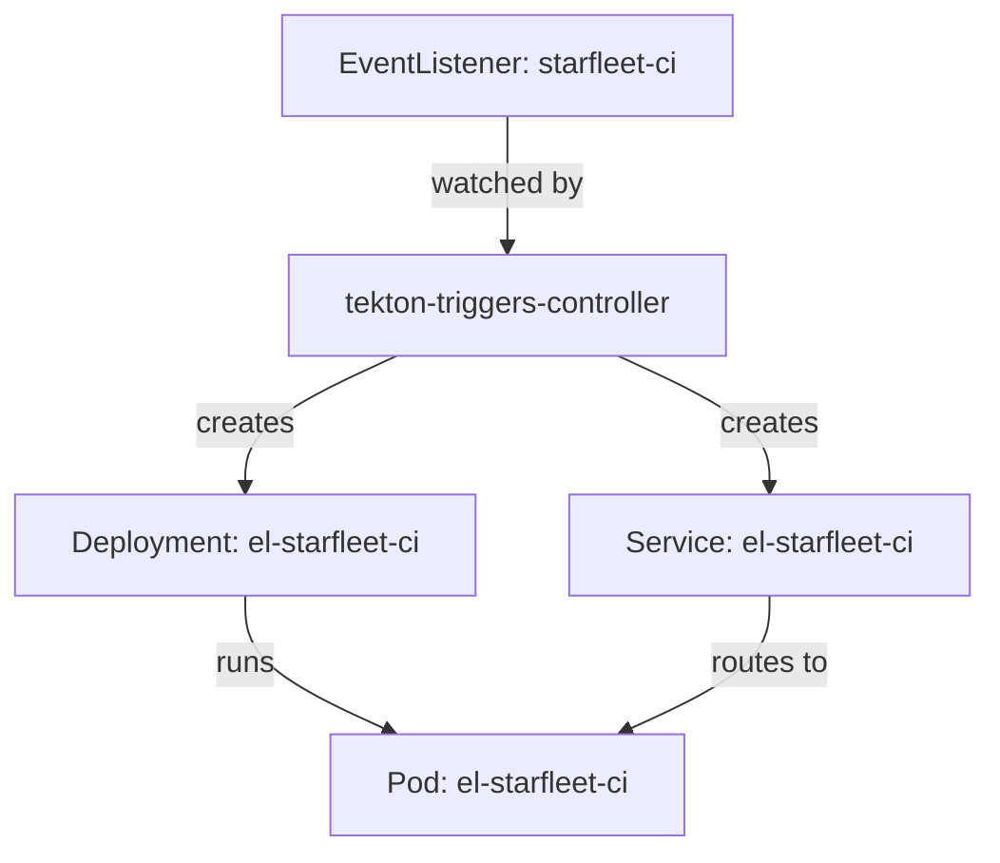

# Read An EventListener's Spec And Status

When an event does not start a build, the first question is whether the EventListener is healthy at all. The EventListener object answers that question in its `status`, and its `spec` shows what the controller was asked to build. Reading both quickly is the first skill of every Triggers troubleshooting session. This part names the fields and reads the status of the EventListener in the playground.

## The fields of the spec

The `spec` of an `EventListener` (`triggers.tekton.dev/v1beta1`) has these fields:

- `serviceAccountName` is required. The EventListener pod runs with this ServiceAccount and creates the objects of every Trigger with it.
- `triggers` is a list of Triggers written inline: each has interceptors, bindings and a template.
- `triggerGroups` is a list of groups. A group has a `name`, a list of `interceptors` that run once for the whole group, and a `triggerSelector` that picks the Triggers of the group.
- `namespaceSelector` and `labelSelector` choose standalone `Trigger` objects by namespace and by label.
- `resources` shapes the Deployment and the Service that the controller creates.
- `cloudEventURI` is the address to which the EventListener sends CloudEvents.

Most EventListeners use only `serviceAccountName` and `triggers`. The next parts come back to `resources` and the selectors.

## Read the status

The controller writes the result of its work into `status`. Look at the EventListener of the playground first as a table:

<!-- astrona:playground:renew -->

```sh
kubectl get eventlistener starfleet-ci -n starfleet
```

The columns are `ADDRESS`, `AVAILABLE`, `REASON`, `READY` and a second `REASON`. The address is the URL that clients use. `AVAILABLE` follows the Deployment, and `READY` is the condition that the rest of this course checks before it sends an event. Now read the same fields as YAML:

```sh
kubectl get eventlistener starfleet-ci -n starfleet -o jsonpath='{.status.address.url}{"\n"}{.status.configuration.generatedName}{"\n"}'
kubectl get eventlistener starfleet-ci -n starfleet -o jsonpath='{range .status.conditions[*]}{.type}={.status}{"\n"}{end}'
```

The first command prints the address of the Service and the generated name of the Deployment and the Service, `el-starfleet-ci`. The second prints one line for every condition. The `Ready` condition follows the `Available` condition of the Deployment: the EventListener is ready when its pod can serve requests.

## Find what the controller created

The controller labels everything it creates for an EventListener with `eventlistener=<name>`. Use the label to list the pieces:

```sh
kubectl get deployment,service,pod -n starfleet -l eventlistener=starfleet-ci
```



The diagram shows that the Deployment and the Service are children of the EventListener: the Triggers controller creates them, and the pod serves the events. The Service has the type `ClusterIP`, so only pods inside the cluster reach port 8080.

The `tkn` command-line tool shows the same object in a readable form:

```sh
tkn eventlistener describe starfleet-ci -n starfleet
```

It prints the name, the namespace, the ServiceAccount, the Triggers and their bindings and templates.

## Ask the cluster for field documentation

The Triggers CRDs (custom resource definitions) carry a schema, so `kubectl explain` documents every field of the version installed in the cluster:

```sh
kubectl explain eventlistener.spec.resources.kubernetesResource
```

> [!TIP]
> `kubectl explain` answers a field question faster than any web page and always matches the installed version. Use `--recursive` to print the whole tree under a field.

You can now read the fields of an EventListener and its status, and you know which objects the controller creates from it. The open question is how to change those objects, since the controller does not let you edit them directly.

## Common pitfalls

> [!WARNING]
> - **Editing the Deployment `el-<name>` by hand.** The controller reconciles it back to what the EventListener says. Change the EventListener instead.
> - **Looking for the pod by the EventListener's name only.** The pod and the Service are named `el-<name>`. The label `eventlistener=<name>` finds them reliably.
> - **Reading only the `READY` column.** If it is `False`, read the condition messages with `-o yaml`: they name the cause.
> - **Treating `triggers` and `triggerGroups` as the same.** A group runs its interceptors once for several Triggers; an inline Trigger runs its own interceptors.
