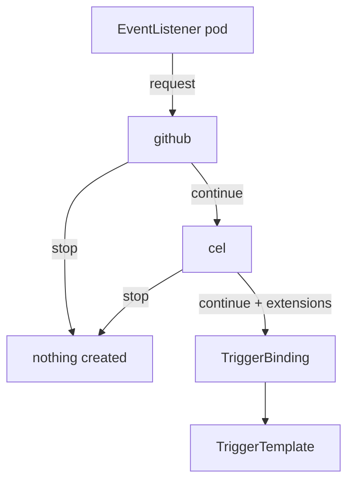

# How Interceptors Work

The EventListener `starfleet-ci` in your playground trusts every request. It reads the commit ID, the branch and the repository address from the body and starts a build with them, without asking who sent the body. Before you add any checks, you need to know where they plug in, which component runs them, and how you can tell that a check stopped an event. This part shows the problem, explains the chain of interceptors, and adds a first, simple interceptor.

## Every request starts a build

Send a request that no Git server would ever send: a made-up branch, a commit ID that is not a commit ID, and a repository address on another host.

<!-- astrona:playground:renew -->

```sh
kubectl exec -n starfleet deploy/webhook-client -- curl -sS -X POST -H 'Content-Type: application/json' --data-binary '{"ref":"refs/heads/anything","head_commit":{"id":"not-a-commit"},"repository":{"clone_url":"https://other.example.com/x.git"}}' http://el-starfleet-ci.starfleet.svc.cluster.local:8080
kubectl get pipelineruns -n starfleet -l triggers.tekton.dev/eventlistener=starfleet-ci
```

The EventListener answered `202`, and a new `ci-build-run-` run exists with `revision` = `not-a-commit`. The binding did exactly what it was told: it copied fields. Nothing in a `TriggerBinding` or a `TriggerTemplate` can say no to an event. That is the job of interceptors.

## The chain of interceptors

An interceptor is a step that runs before the bindings of a Trigger. Each Trigger can list several interceptors under `interceptors`, and the EventListener pod calls them in that order, one after the other:



The EventListener sends each interceptor the body, the headers and the `extensions` so far, and each interceptor answers continue or stop; the first stop ends the Trigger, and only a full chain of continues reaches the binding.

Three facts follow from this. First, the order matters: put the check that rejects untrusted requests first. Second, an interceptor does not change the body. It adds data under the top-level field `extensions`, which the next interceptor gets and which a binding reads as `$(extensions.<key>)`. Third, the chain belongs to one Trigger. An EventListener with two Triggers runs two chains for the same request, and one can stop while the other continues.

## ClusterInterceptors and the core interceptors

An interceptor that a Trigger names under `ref` is a `ClusterInterceptor`, a cluster-scoped object that says where the interceptor runs. Look at the one for GitHub:

```sh
kubectl get clusterinterceptor github -o jsonpath='{.spec.clientConfig.service}{"\n"}'
```

It points at the Service `tekton-triggers-core-interceptors` in `tekton-pipelines`, port `8443`, path `github`. The other four, `gitlab`, `bitbucket`, `cel` and `slack`, point at the same Service with their own paths. One Deployment, `tekton-triggers-core-interceptors`, serves all five over HTTPS. Its pod writes its CA certificate into each ClusterInterceptor, and the EventListener uses it to trust the connection.

The shipped interceptors cover the common cases:

| ClusterInterceptor | What it checks or does |
| --- | --- |
| `github` | The event type in `X-GitHub-Event`, and the HMAC signature in `X-Hub-Signature-256` |
| `gitlab` | The event type in `X-Gitlab-Event`, and the plain token in `X-Gitlab-Token` |
| `bitbucket` | The event type in `X-Event-Key`, and for Bitbucket Server the signature in `X-Hub-Signature` |
| `cel` | A `filter` expression that must be true, and `overlays` that add values to `extensions` |
| `slack` | Copies the fields of a Slack slash command form into `extensions` |

You can also write your own interceptor: an HTTP server that accepts the same request format and answers continue or stop, registered with its own `ClusterInterceptor`, or a namespaced `Interceptor` object for one namespace. Older EventListeners use a `webhook` interceptor instead, which calls a plain Kubernetes Service on port 80; Triggers keeps it for compatibility.

## A first interceptor: event types

The `github` interceptor has two jobs, and you can use them separately. With only the parameter `eventTypes`, it checks the header `X-GitHub-Event` against a list and does nothing else. Add it to the Trigger, with a `name` that says what it does.

Save this as `eventlistener-starfleet-ci.yaml`:

```yaml
apiVersion: triggers.tekton.dev/v1beta1
kind: EventListener
metadata:
  name: starfleet-ci
  namespace: starfleet
spec:
  serviceAccountName: starfleet-triggers
  triggers:
    - name: github-push
      interceptors:
        - name: only-push-events
          ref:
            name: github
          params:
            - name: eventTypes
              value: ["push"]
      bindings:
        - ref: github-push
      template:
        ref: ci-build-run
```

Apply it:

```sh
kubectl apply -f eventlistener-starfleet-ci.yaml
```

Now send the push payload, but label it as a pull request event:

```sh
kubectl exec -n starfleet deploy/webhook-client -- curl -sS -X POST -H 'Content-Type: application/json' -H 'X-GitHub-Event: pull_request' --data-binary @/payloads/push-main.json http://el-starfleet-ci.starfleet.svc.cluster.local:8080
kubectl logs -n tekton-pipelines deploy/tekton-triggers-core-interceptors --tail=3
```

The EventListener answered `202` as always, and no new run appears. The core interceptors log every answer at the info level, in a line whose message starts with `Interceptor response is:`. The newest one has `Continue:false` and the message `event type pull_request is not allowed`. That log is the place to look whenever an event creates nothing.

Send the same body with the header `X-GitHub-Event: push` and a new run appears. So the interceptor now refuses the wrong event types, but it trusts the header. Any client can write `X-GitHub-Event: push`, and the first request of this part would still start a build with it.

You now know where interceptors sit, which Deployment runs them, how they pass data on, and where a stopped event leaves its trace. The check you added reads a header that anyone can set. The open question is how the EventListener can tell that a request really comes from the Git server.

## Common pitfalls

> [!WARNING]
> - **Expecting an error response.** The EventListener answers `202` before the interceptors run. A rejected event shows up only as a missing run and a log line.
> - **Looking in the wrong log.** The reason an interceptor stopped an event is in the log of `tekton-triggers-core-interceptors` in `tekton-pipelines`, not in the EventListener pod.
> - **Trusting `eventTypes` alone.** It reads `X-GitHub-Event`, which any client can set. It filters; it does not verify.
> - **Putting a filter after a slow or permissive step.** Interceptors run in list order. Put the check that rejects untrusted requests first.
> - **Expecting an interceptor to change the body.** ClusterInterceptors add data under `extensions`; the body stays as it was sent.
